# Budgeter

Pixel-art Android budget planner for one person. Set a monthly budget and a savings target, see what you can spend today (unspent days carry forward), scan receipts on the phone and split them per item including service charge and GST, plan trips and save for them month by month, and keep everything in your own Google Sheet. Track meals and macros, and share a date budget with your partner. Three home-screen widgets.

There's also a web version, [Budgeter Web](https://github.com/nyx-ulrix/budgeter-web), at https://app.budgeter.liewjiaen.com. With Google Sheets sync on in both, the phone and the web app share everything: expenses, budget, planned purchases, trips, categories and settings.

Plan and decisions: [PLAN.md](PLAN.md). Art list: [docs/GRAPHICS.md](docs/GRAPHICS.md). Sheets setup: [docs/google-setup.md](docs/google-setup.md).

## Screenshots

| Home | Month in numbers | Budget | Transactions |
|---|---|---|---|
| 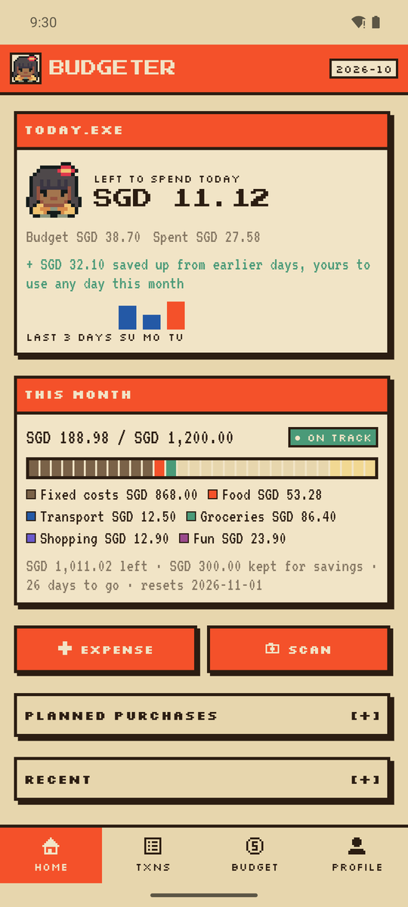 | 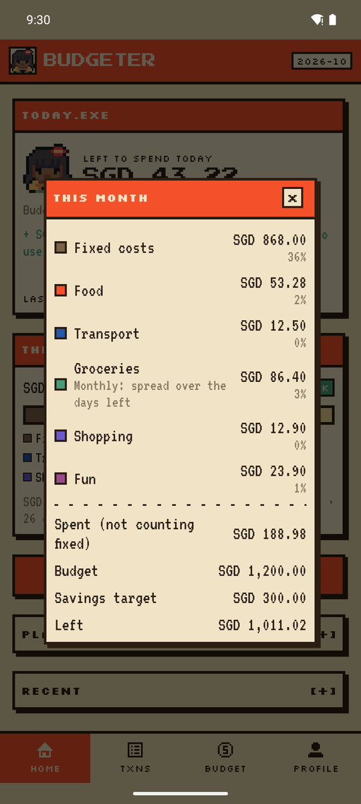 | 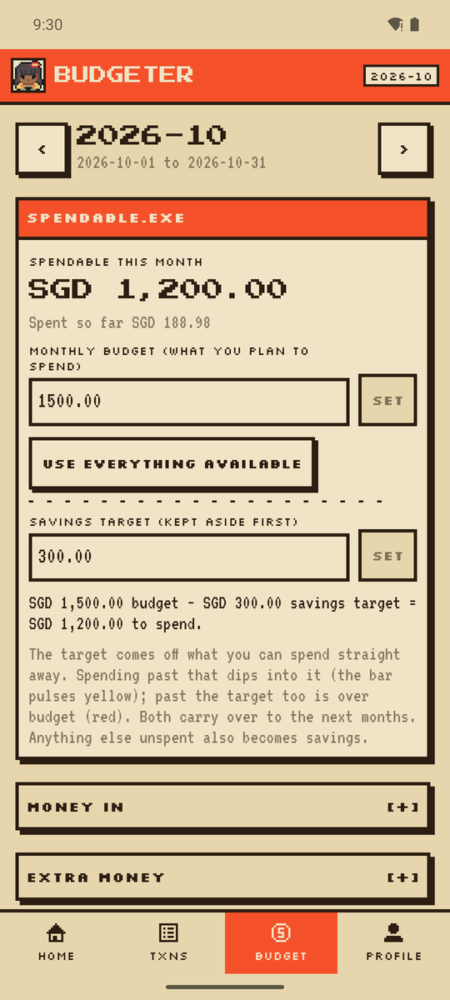 | 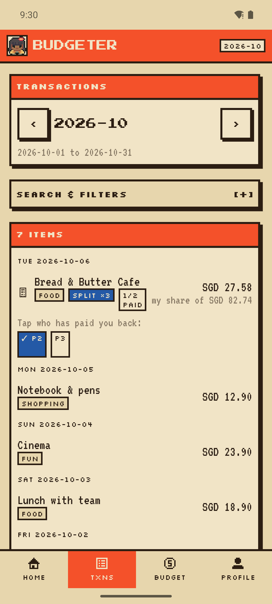 |

| Receipt split by item | Trip budget | Receipt camera | Widgets |
|---|---|---|---|
| 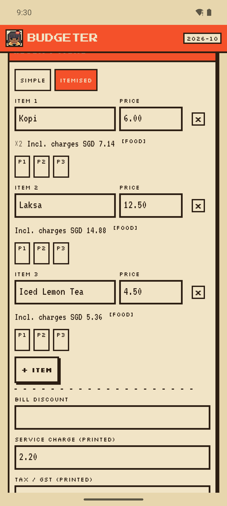 | 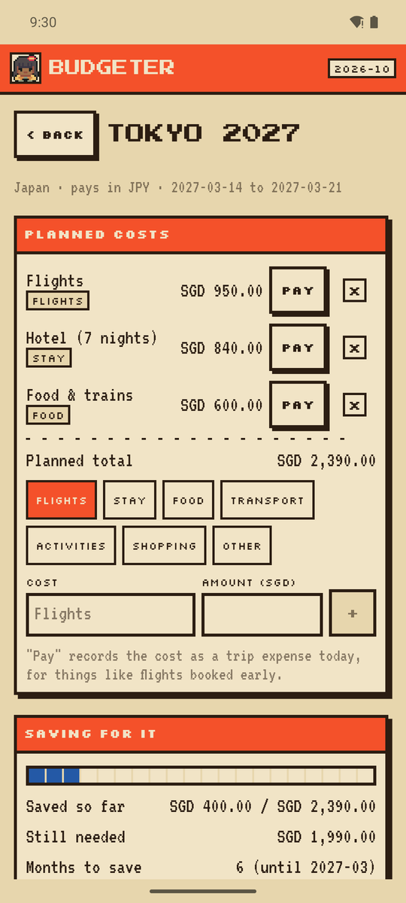 | 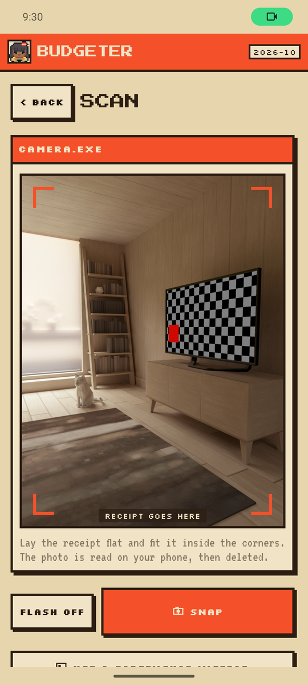 | 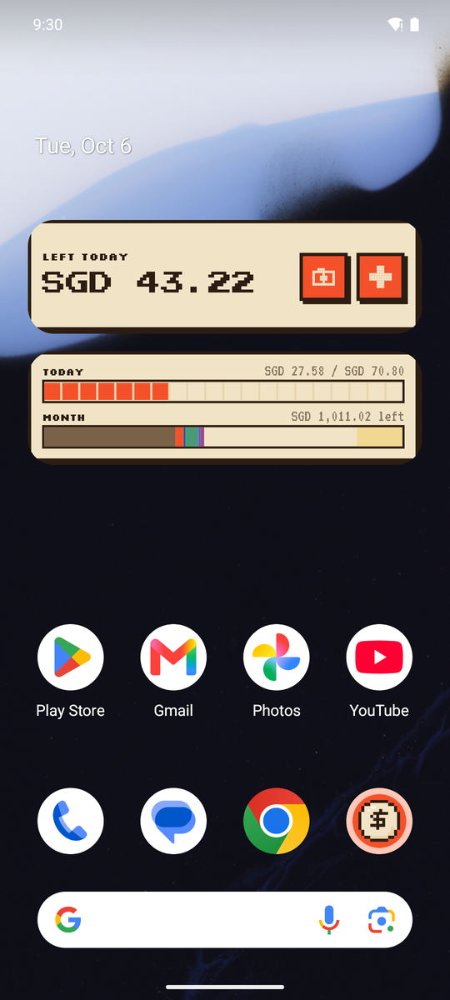 |

## How it fits together

Three front ends share two kinds of data. Each person's own budget lives in their device and their own Google Sheet; the date budget shared by a couple lives in Budgeter's Firebase project. There is no Budgeter server.

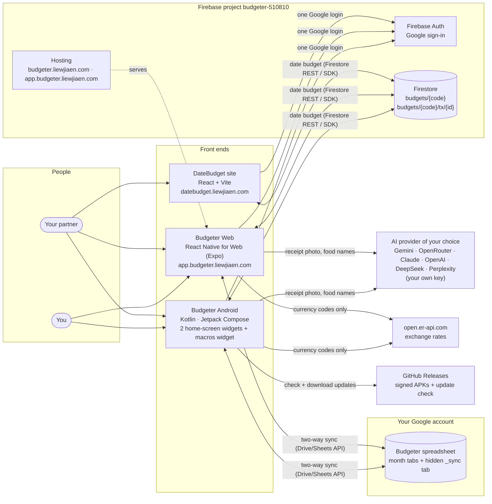

Inside each app the layers are the same, and the Kotlin and TypeScript versions mirror each other file for file (`core/*.kt` ↔ `src/core/*.ts`, `data/*.kt` ↔ `src/data/*.ts`), with the same tests.

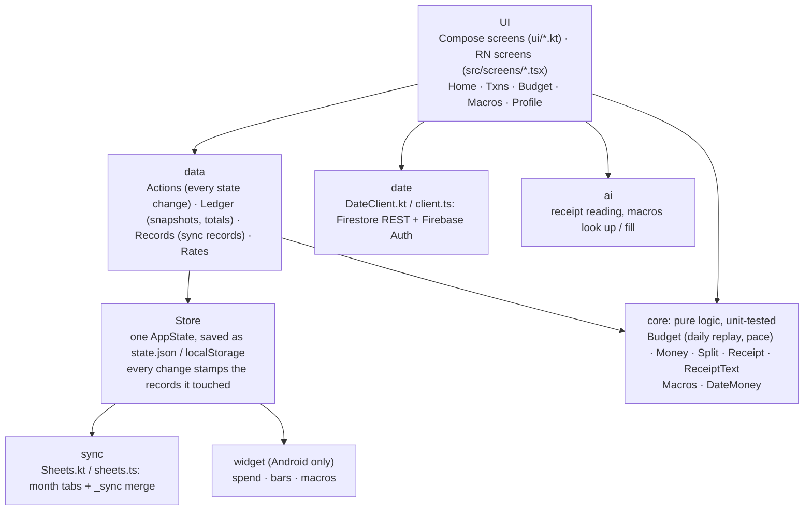

### Two-way sync (phone ↔ web)

Every record (`setup`, `categories`, `macros`, `plan:<month>`, `txn:<id>`, `planned:<id>`, `trip:<id>`, `meal:<id>`, `preset:<id>`) carries the time it last changed. Each sync keeps whichever copy is newer; a delete is an empty record with a stamp, so it wins too.

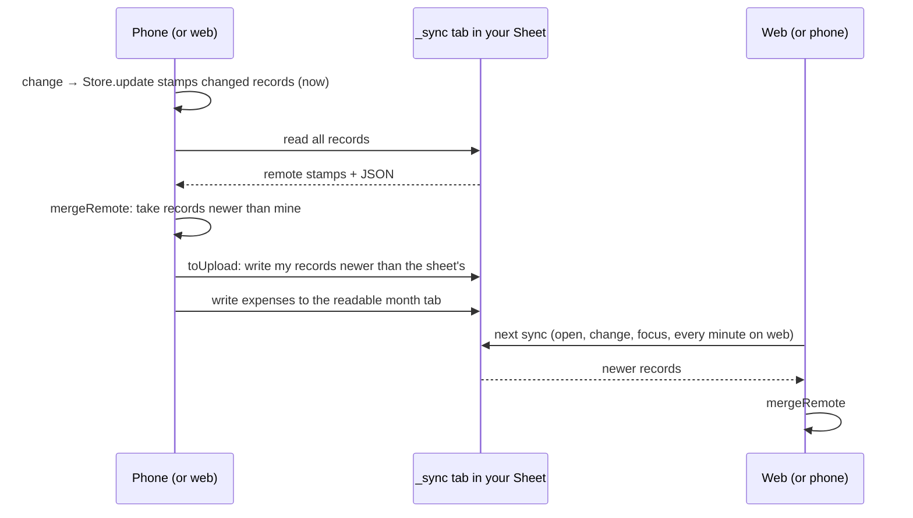

### Today's budget

What you can spend today is replayed day by day from the start of the budget month, so unspent money carries forward and spending on monthly categories (groceries, bills) lowers every remaining day instead of today alone.

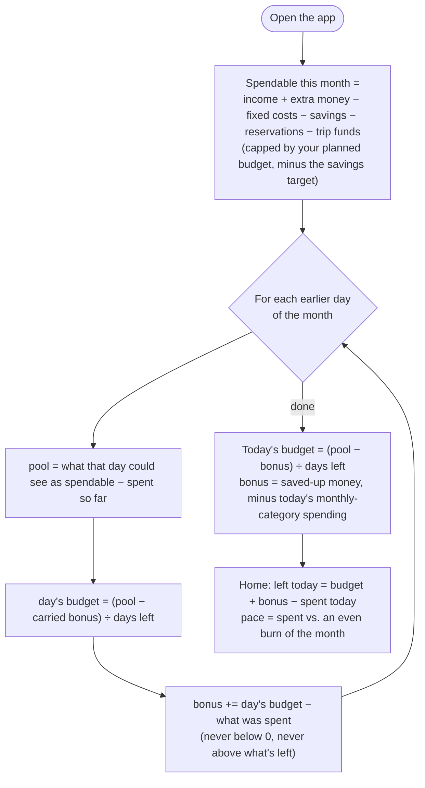

### Scanning a receipt

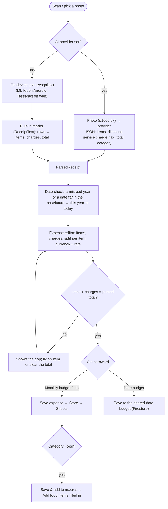

### Date budget (shared with a partner)

One Google login: the phone signs in quietly with the account it already used (and on Connect Google), the web reuses its Google Sheets token, and the DateBudget site uses Google's sign-in button. All three then read and write the same Firestore documents with the same rules.

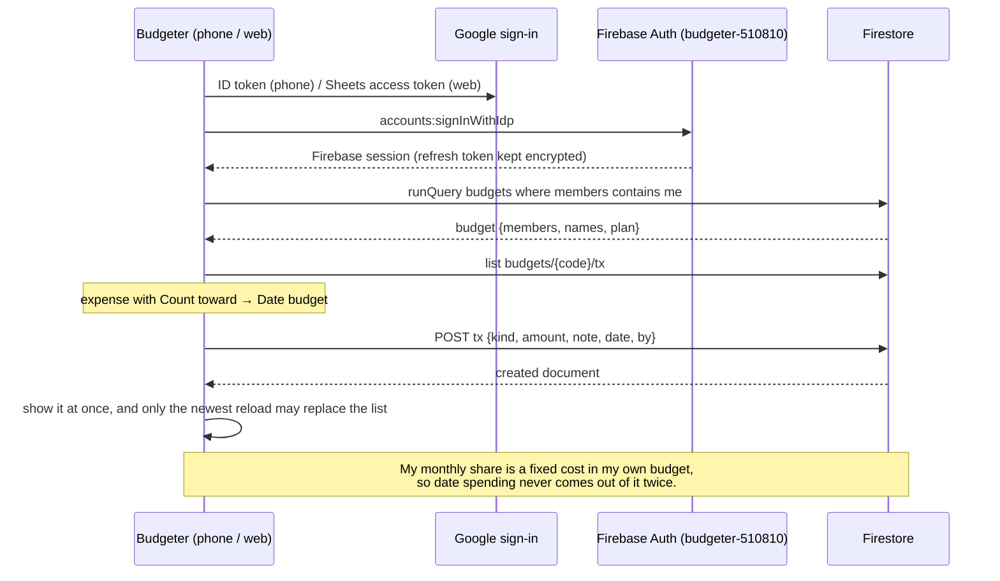

### Macros

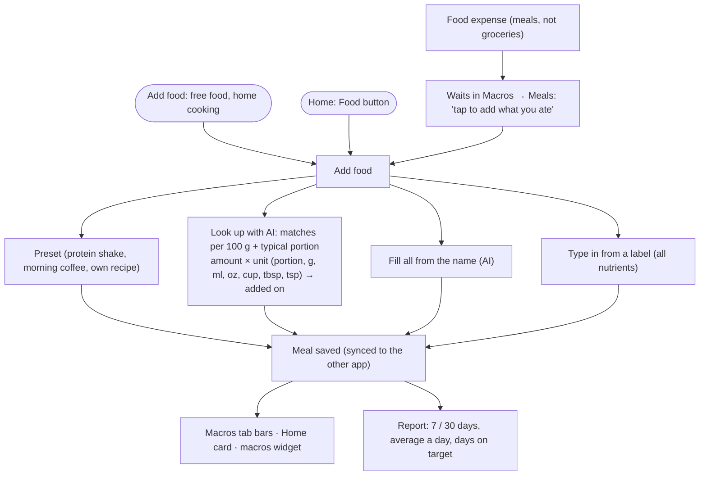

### Releasing

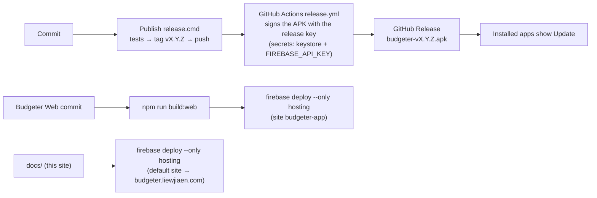

## Platforms this project uses

| Platform | What it's for | Where |
|---|---|---|
| **GitHub** | Code, issues, release builds and APK downloads | [nyx-ulrix/budgeter](https://github.com/nyx-ulrix/budgeter) (Android app + website in `docs/`), [nyx-ulrix/budgeter-web](https://github.com/nyx-ulrix/budgeter-web) (web app), nyx-ulrix/DateBudget (private, DateBudget site). Actions: `.github/workflows/release.yml`. Repository secrets: `BUDGETER_KEYSTORE_B64`, `BUDGETER_KEYSTORE_PASSWORD`, `FIREBASE_API_KEY`. |
| **Firebase project `budgeter-510810`** | Hosting for the website and web app; Firestore and Auth for the shared date budget | [Firebase console](https://console.firebase.google.com/project/budgeter-510810). Hosting sites: default → budgeter.liewjiaen.com (`docs/`), `budgeter-app` → app.budgeter.liewjiaen.com. Firestore `(default)` in asia-southeast1, rules from the DateBudget repo's `firestore.rules`. Auth: Google provider; authorized domains include both sites and datebudget.liewjiaen.com. Apps: "Budgeter" web + Android (package `com.nyxulrix.budgeter`, release SHA-1 registered). |
| **Google Cloud (same project)** | Google sign-in and API keys | [Credentials](https://console.cloud.google.com/apis/credentials?project=budgeter-510810). OAuth clients: "Budgeter Web" (origins app.budgeter.liewjiaen.com, datebudget.liewjiaen.com, localhost:8081) and the Android client for Sheets. API keys: "Browser key (auto created by Firebase)" for the web and DateBudget site, "Android key (auto created by Firebase)" for the phone, each restricted to its apps and to Auth/Firestore. Enabled APIs: Drive, Sheets, Firestore, Identity Toolkit, Firebase Rules, API Keys. No billing account. |
| **Google Drive / Sheets (each user's own)** | Each person's budget, synced between their phone and browser | The user's Drive: one spreadsheet named "Budgeter" (scope `drive.file`, so the apps only see files they made). |
| **Firebase project `datebudget`** | Hosting for the DateBudget site; the old date budget database, kept as a backup | [Firebase console](https://console.firebase.google.com/project/datebudget). Hosting → datebudget.liewjiaen.com. Its data now lives in `budgeter-510810`. |
| **Cloudflare** | DNS for liewjiaen.com | CNAME records (DNS only, not proxied) for budgeter, app.budgeter and datebudget pointing at Firebase Hosting. |
| **AI providers** (optional, user's own key) | Reading receipt photos; macros look up and fill | Gemini, OpenRouter, Anthropic, OpenAI, DeepSeek or Perplexity, set in Profile → AI. Keys are encrypted on the device (Android Keystore / browser WebCrypto) and never synced. |
| **open.er-api.com** | Daily exchange rates for spending abroad | Free, no key; only currency codes are sent. |
| **Developer machine** | Building and publishing | Android Studio (its JDK in `jbr/`), Android SDK, Node.js (web app and DateBudget site), Firebase CLI, GitHub CLI. Not in git: `keystore.properties` + the release key in `%USERPROFILE%\.android\`, `BudgeterWeb/.env.local` and `DateBudget/.env.local` (the Firebase web key). |

## Code map

[`graphify-out/graph.html`](graphify-out/graph.html) is an interactive map of the code (open it in a browser after cloning); [`graphify-out/GRAPH_REPORT.md`](graphify-out/GRAPH_REPORT.md) summarises its main parts. Regenerate it with `graphify update .` after code changes.

## Get the app

Download the latest `budgeter-vX.Y.Z.apk` from [Releases](https://github.com/nyx-ulrix/budgeter/releases/latest) and open it on the phone. After that the app updates itself: when a new release is out it shows a blue **Update** strip, or use Profile → Updates → Check for updates.

## Install from this PC (any plugged-in Android device)

Double-click **`Install on phone.cmd`**. It builds the app, waits for a device, and installs and opens it on every phone plugged in by USB.

The phone needs USB debugging once: Settings → About phone → tap **Build number** 7 times, then Developer options → **USB debugging**. On Oppo/ColorOS: Settings → About device → Version → tap Build number. Accept the "Allow USB debugging" prompt when you plug in.

## Publish an update

1. Commit your changes.
2. Double-click **`Publish release.cmd`** and type the new version, for example `0.3.0`.

It runs the tests, tags the commit and pushes. GitHub Actions ([release.yml](.github/workflows/release.yml)) builds the signed APK and publishes the release, and installed apps offer the update.

Every build, from this PC or from GitHub, is signed with the same release key (`keystore.properties`, not in git; the key file lives in `C:\Users\malco\.android\`). Android only installs an update signed with that key, so **keep a backup of the key file and `keystore.properties`**. Losing them means users must uninstall to get new versions.

## Tests

```bash
./gradlew testDebugUnitTest
```

Windows needs Android Studio's Java first, for example in Git Bash: `export JAVA_HOME="C:/Program Files/Android/Android Studio/jbr"`.

## Cheapest AI setup

Get a free Gemini key at https://aistudio.google.com/apikey and add it under Profile → AI receipt reading. Without any key the built-in offline reader is used.
